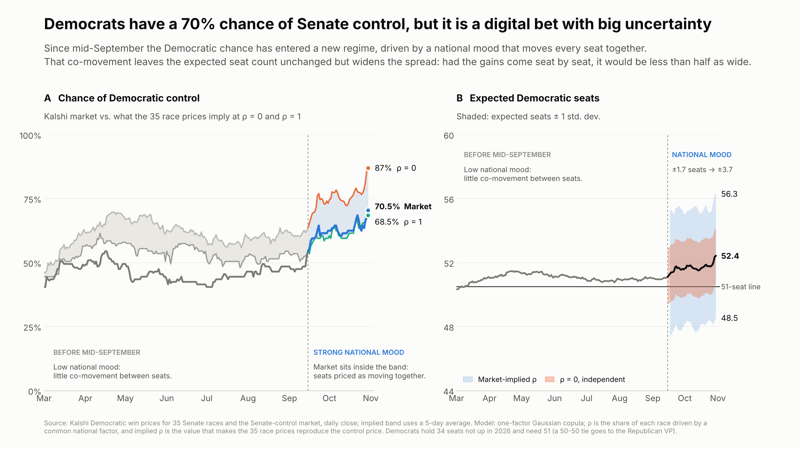
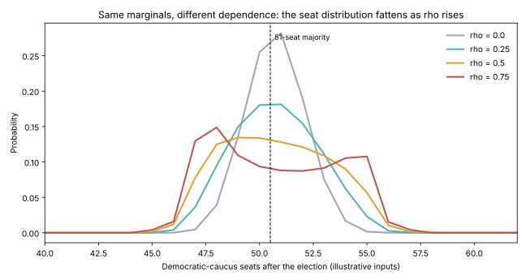

# Senate seat counts: independent races vs a Gaussian copula

*Masoud Jafari, CFA*

## Question

If each Senate race keeps the same win probability, how much does a shared "national mood" shock (dependence between races) change the odds of extreme outcomes?

This is the same structure as a credit portfolio: each race is a "name", a Democratic win is a "default", and the seat count is the portfolio loss. A one-factor Gaussian copula is the Vasicek / CDO-pricing model, applied here to elections.

## Data

The repo holds two analyses that use the same model:

| Folder | Inputs | What it shows |
|---|---|---|
| [`synthetic/`](synthetic/) | `synthetic/data/races.csv`: a stylized map built from rating buckets (Safe / Likely / Lean / Toss-up) with assumed margins | How dependence alone reshapes the seat distribution |
| [`kalshi/`](kalshi/) | Real Kalshi prices, November 2026: the 35 Senate races and the Senate-control market | The correlation between races that the market implies |

> **The synthetic inputs are not a forecast.** They are tuned to sit near a knife-edge so the effect of dependence is easy to see. Replace the margins with your own polling averages to run the model on real data.

## Method

1. Each contested race *i* has an expected Democratic margin `mu_i` and a total uncertainty `SIGMA = 4.5` points, giving a marginal win probability `p_i = Phi(mu_i / SIGMA)`.
2. **Independent model (rho = 0):** each race is an independent coin flip with probability `p_i`.
3. **Gaussian copula:** `Z_i = sqrt(rho) * M + sqrt(1 - rho) * e_i`, with `M` the common national factor and `e_i` the race-specific noise. Race *i* is a Democratic win when `Phi(Z_i) < p_i`.
4. `rho` is the share of each race's variance driven by the national factor. Marginals are identical for every `rho`; only the dependence changes.
5. 400,000 simulations per `rho`. 34 Democratic-caucus seats are not up, and 51 seats are needed for control.

The Kalshi analysis takes the race prices as the marginals and solves for the `rho` that reproduces the Senate-control price. See [`kalshi/TUTORIAL.md`](kalshi/TUTORIAL.md) for the details.

## Result

### Real market data: Kalshi, 30 Oct 2026

- Kalshi gave Democrats a **70.5%** chance of control. Treated as independent, the race prices would give **87%**. The implied correlation that reconciles the two is **rho ≈ 0.38**.
- Expected Democratic seats are **52.4** at any rho, but the standard deviation is **3.7 seats** at the implied rho against **1.7** with independent races.



### Synthetic inputs

| rho | mean seats | sd | 5th–95th pct | P(≥51) | P(≥55) | P(≤45) |
|---|---|---|---|---|---|---|
| 0.00 | 50.74 | 1.35 | 49–53 | 56.6% | 0.2% | 0.0% |
| 0.25 | 50.74 | 1.96 | 48–54 | 53.5% | 2.6% | 0.0% |
| 0.50 | 50.74 | 2.43 | 47–55 | 51.6% | 6.8% | 0.2% |
| 0.75 | 50.74 | 2.84 | 47–55 | 49.9% | 12.7% | 0.4% |



**Findings**

- The **expected seat count does not move** (50.74 in every row), because the marginals are fixed. Looking only at the average hides the effect of dependence.
- **Tails grow fast.** From rho = 0 to 0.75, the standard deviation of seats more than doubles, and the chance of a 55+ seat result rises from 0.2% to 12.7%. Independence badly understates blowout outcomes.
- **Near the majority line, dependence lowers the probability of the favored outcome:** P(≥51) falls from 56.6% to 49.9%, because probability mass moves from the middle into both tails. Correlation does not simply raise or lower the odds; it depends on which side of the threshold the mean sits.
- This mirrors tranche risk in credit: correlation barely changes expected loss but strongly changes the probability of extreme losses.

## Limitations

- In the synthetic demo, `rho` is a sensitivity parameter, **not calibrated**.
- A Gaussian copula has no tail dependence. Real "wave" elections may cluster more than this model allows (compare Student-t copulas).
- State-level correlation is uniform here. In practice, similar states (demographics, region) move together more than dissimilar ones.
- Synthetic race margins and the total uncertainty are assumed, not estimated.

## Run it

```bash
pip install -r requirements.txt

cd synthetic && python senate_copula.py      # writes results/results.csv and charts/seat_distribution.svg
cd ../kalshi && python kalshi_implied_rho.py # writes results/control_series.csv and charts/*.png
```

Edit `synthetic/data/races.csv` and the assumptions at the top of `synthetic/senate_copula.py` to experiment.

## Next steps

- Calibrate `rho` from historical polling-error correlation across states.
- Swap in a Student-t copula and compare tail behavior.
- Add a state-similarity correlation matrix instead of a single factor.

## Read more

- Full write-up of the Kalshi analysis: [`kalshi/TUTORIAL.md`](kalshi/TUTORIAL.md)
- Short version [on LinkedIn](https://www.linkedin.com/feed/update/urn:li:ugcPost:7522806196270198784)
