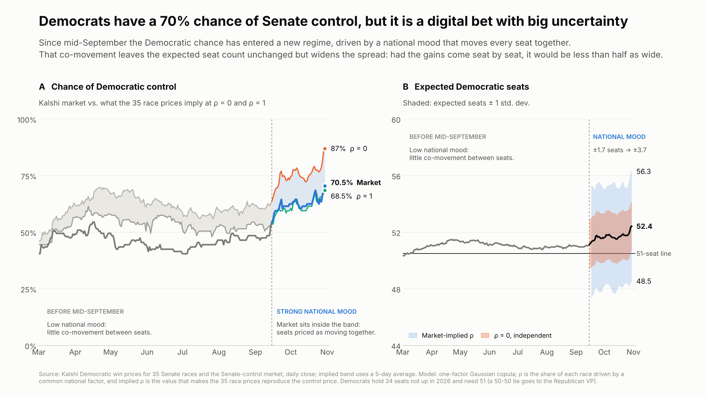

# Who will control the US Senate? Reading uncertainty behind bets with a Gaussian copula

*Masoud Jafari, CFA. Data: Kalshi daily close, 30 Oct 2026 (the 31 Oct 04:00 UTC candle).*



## Why this matters

Prediction markets such as Kalshi and Polymarket were meant to be an upgrade on opinion polls, which famously missed Trump's first win in 2016. The argument was simple: when people bet their own money, prices should track reality better than survey answers.

Yet two recent elections still surprised many people. In Brazil, Kalshi had Flávio Bolsonaro at 70–85% for most of the year, with Lula near 25–30% going into the vote. Lula won, and his price jumped to 100% only as the results came in. In Israel, Gadi Eizenkot traded at roughly 45–55% as the favourite for prime minister, while Netanyahu sat near 20–30%. Once the votes were counted, the prices swung sharply. In both cases the big moves came after the election, not before it.

So are these markets biased, unrepresentative, or even manipulated? Neither. The Brazil curve gave Lula a real chance, roughly one in four, and one-in-four events happen. The mistake is to read a price as a prediction. It is a probability, and a probability on its own says nothing about how uncertain the outcome is. To see that, we need the whole distribution, not just the headline number.

For a market-risk desk this matters directly. The House outcome looks largely priced in, so the Senate result is the political event that can reset market expectations after election day.

## A Senate bet is a digital option

The Kalshi control market pays 1 or 0, like a digital option. Democrats hold 34 seats that are not up in 2026, and a 50–50 tie goes to the Republican Vice President. So Democrats need 17 of the 35 races: 16 pays nothing, 17 or more pays in full. Near that line, how sharply the value reacts to a small swing matters more than the value itself.

Kalshi also lists a market for each of the 35 races. We can treat the control bet as an option on a basket of 35 smaller digital options, one per seat.

## How the seats move together

To link the basket to the control market we use a one-factor Gaussian copula, the same tool used for default correlation in credit portfolios. Each race depends partly on a shared national mood and partly on local factors:

```
Z_i = sqrt(rho) * M + sqrt(1 - rho) * e_i        race i is a Democratic win when Phi(Z_i) < p_i
```

`p_i` is the race's Kalshi price, so every race keeps its market probability exactly. `rho` only sets how much of each race comes from the shared factor `M`.

| Setting | What it means | Chance of Democratic control (30 Oct) |
|---|---|---|
| rho = 0 | every race independent | 87.0% |
| rho = 1 | one swing decides everything | 68.5% |
| **Kalshi market** | | **70.5%** |
| implied rho = 0.38 | the rho that reconciles the 35 race prices with 70.5% | 70.5% |

The implied rho is the market's own estimate of how strongly the races move together, in the same way implied volatility is backed out of an option price. Note that rho measures how strongly the races move together, not which way: the Democratic lean sits in the race prices.

## Two regimes

Panel A of the chart shows two regimes:

- **Since mid-September (15 Sep 2026)**, the market sits inside the band between rho = 0 and rho = 1, and the implied rho has moved between roughly 0.2 and 0.5. The races are priced as one shared bet.
- **Before mid-September**, the market price sat below both lines, so no single rho could reconcile it with the race prices. We label this period "low national mood", but strictly the one-factor model does not fit there; the gap may reflect pricing frictions, thin markets or a risk premium rather than measured co-movement.

## Same expected seats, more than twice the spread

Correlation does not move the expected seat count: it is 34 plus the sum of the race probabilities, 52.4 on 30 Oct, at any rho. The rise from about 51 to 52.4 since September comes from the race prices themselves.

What correlation changes is the spread (panel B):

| | Independent (rho = 0) | Market-implied (rho = 0.38) |
|---|---|---|
| Expected Democratic seats | 52.4 | 52.4 |
| Standard deviation | 1.7 seats | 3.7 seats |
| ±1 SD range | about 50.7–54.2 | 48.5–56.3 |
| Cushion above the line, (E − 50.5) / SD | 1.11 SD | 0.52 SD |
| Chance Democrats fall short (≤ 50 seats) | 13% | 29.5% |

The headline 70% rests on a cushion about half as thick as independent races would suggest, and a modest national swing can take Democrats below 51 seats. The same shared factor also fattens the upside: a Democratic wave of 55+ seats is about 27% at the implied rho, against about 11% with independent races.

## How to read the poll

A high probability is only half the story. The other half is how fragile it is. Here a strong implied national mood means the races are effectively one bet, not 35 separate ones. That bet is a 70% favourite with a wide distribution behind it. In a tight race in a polarised society, where seats move together, the uncertainty around the expected value matters more than the value itself.

For a risk manager the practical consequences are:

- treat the Senate as one binary event in scenario and stress testing on and after election night;
- size the two stress legs from the distribution, not the headline: Republicans keep control about 30% of the time, and a Democratic wave of 55+ seats is about 1 in 4;
- expect any surprise to arrive through many races at once, not one.

## Caveats

- The one-factor Gaussian copula has no tail dependence. Fatter-tailed models (Student t, Clayton) fitted to the same 70.5% widen the tails further.
- Before mid-September no implied rho exists, so the implied band in panel B starts on 15 Sep 2026 and uses a 5-day average because the daily implied rho is noisy.
- Race prices are Kalshi daily closes; thinly traded safe seats can carry stale quotes.
- Day-to-day co-movement of race prices is far lower than the implied rho (realized rho near 0.03). Like implied versus realized volatility before an event, daily moves do not show the one-time election-night shock the market is pricing.

## Reproduce

```bash
pip install -r ../requirements.txt
cd kalshi
python kalshi_implied_rho.py
```

This reads `data/`, writes the daily series to `results/control_series.csv` and redraws the charts in `charts/`. The charts use the Inter font if it is installed and fall back to the default font otherwise.
